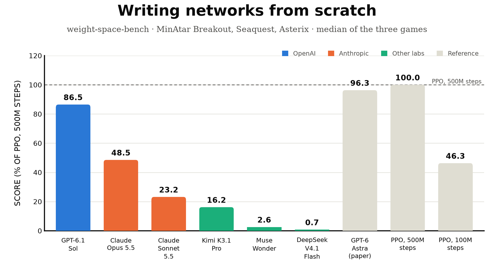
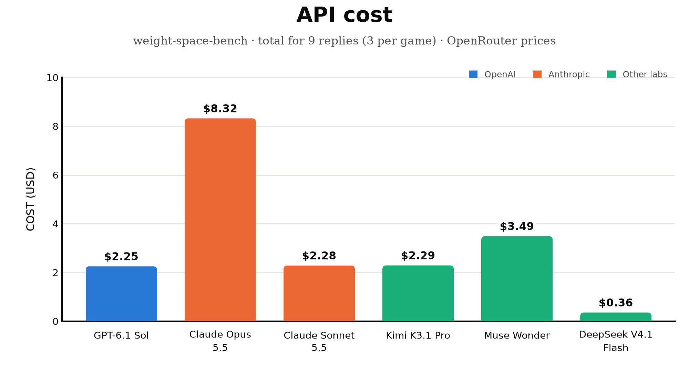
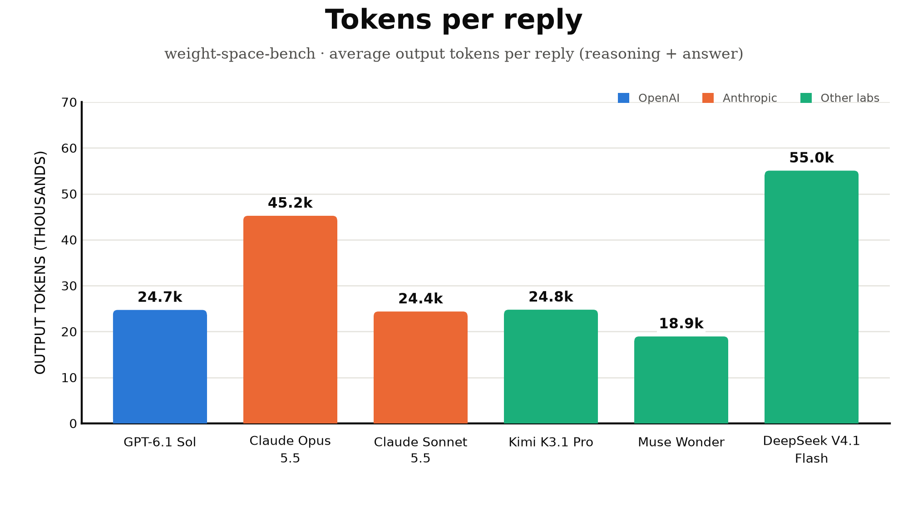

# weight-space-bench

**Can an LLM write the weights of a working neural network from scratch?**

This benchmark runs Experiment 5 of
[Sparks of Weight-Space Programming](https://rikiyat.github.io/blog/weight-space-programming/) on many models. For three
MinAtar games (Breakout, Seaquest, Asterix), each model gets:

- the game's rules and source code;
- a 600 → 32 → 32 → 6 policy network with **every weight at 0**.

It must write every weight itself, in one reply. It gets no training, no data, no tools and no chance to run the game.
The network it writes is then played on the real game and scored.

In the paper, GPT-6 Astra's one-shot networks scored **517.4 / 53.1 / 53.2**. PPO trained for 500M steps scored
25.3 / 88.9 / 55.2.

## Results (2026-11-03)



| # | Model | Score | Breakout | Seaquest | Asterix | API cost |
|---|---|---|---|---|---|---|
| 1 | GPT-6.1 Sol | **86.5** | 457.9 | 11.8 | 47.8 | $2.25 |
| 2 | Claude Opus 5.5 | **48.5** | 17.5 | 2.9 | 27.0 | $8.32 |
| 3 | Claude Sonnet 5.5 | **23.2** | 6.6 | 1.0 | 13.2 | $2.28 |
| 4 | Kimi K3.1 Pro | **16.2** | 6.8 | 0.3 | 9.3 | $2.29 |
| 5 | Muse Wonder | **2.6** | 7.4 | 0.6 | 1.9 | $3.49 |
| 6 | DeepSeek V4.1 Flash | **0.7** | 0.7 | 0.2 | 1.8 | $0.36 |
| | *GPT-6 Astra (paper, 1 attempt)* | *96.3* | *517.4* | *53.1* | *53.2* | |
| | *PPO, 500M steps* | *100.0* | *25.3* | *88.9* | *55.2* | |
| | *PPO, 100M steps* | *46.3* | *15.8* | *5.6* | *25.8* | |

Game columns are raw scores: the mean over 3 attempts × 1,000 episodes. The score is defined under "How it's scored"
below. Total API cost for all six models was about $19. Full table: [`leaderboard/leaderboard.md`](leaderboard/leaderboard.md).

Highlights:

- **GPT-6.1 Sol's Breakout networks scored about 18× PPO-500M:** 449.7, 450.0 and 474.0, close to Astra's 517.4.
- **Sol's best Asterix network beat PPO-500M:** 64.9 against 55.2.
- **Seaquest was hard for every model.** The best result was Sol's 18.0, about 20% of PPO-500M.
- **Claude Opus 5.5 ran out of its 64k-token budget on 2 of 9 attempts** before writing any weights. Those attempts
  count as all-zero networks.

| Cost | Tokens |
|---|---|
|  |  |

## How it's scored

1. **Prompt.** Each model gets the paper's exact prompt for each game, in a fresh conversation with the paper's
   one-line system message.
2. **Weights.** The model writes its weights in an `edits` block. The block is read into the all-zero network,
   exactly as in the paper.
3. **Play.** The network plays 1,000 episodes of the official MinAtar 1.0.15 game:
   - actions are sampled from the network's output;
   - sticky actions 0.1;
   - episodes are cut at 10,000 steps;
   - the episode seeds are fixed, so every network plays the same episodes.
4. **Repeat.** Each model does this **3 times per game** (9 replies in total), and the attempts are averaged.
5. **Score.** Each game's score is normalized:
   - **0** = random play (the all-zero network);
   - **100** = the best PPO network trained for 500M steps.

   The **leaderboard score is the median over the three games**, as Atari benchmarks report the median
   human-normalized score. One outlier game can't dominate it.

The scorer reproduces the paper: Astra's released networks score 502.6 / 52.2 / 53.7 here, against 517.4 / 53.1 / 53.2
in the paper, all within 1.4 standard errors.

## Isolated and standardized

- **No tools.** The API request has no tools, plugins or web search. Every reply is audited for tool calls and web
  citations. A model that keeps using them is marked invalid and not ranked.
- **Same conditions.**
  - Every model gets the same prompts, the same reasoning effort (`high`) and the same 64k output budget.
  - Every network is scored on the same episodes.
  - A hash of these settings is saved with each run, and only matching runs are ranked together.
- **Everything is saved** for every reply in `results/minatar/<model>/<game>/attempt_<k>/`: prompt, reply, usage,
  cost, the network, how its edits were read, and its score.

## Quick start

You need Python 3.11+ and an [OpenRouter](https://openrouter.ai) API key. It runs on the CPU; no GPU is needed.

```bash
git clone https://github.com/eomcaleb/weight-space-bench && cd weight-space-bench
pip install -r requirements.txt
export OPENROUTER_API_KEY=sk-or-...

python -m weight_space_bench reference      # optional: check the scorer reproduces the paper (~3 min)
python -m weight_space_bench all            # run every model, then build the leaderboard
```

Or step by step: `python -m weight_space_bench run claude-opus-5.5`, then `python -m weight_space_bench leaderboard`.
If a run is interrupted, run the same command again. It resumes, and saved replies are never paid for twice.

The leaderboard is written to `results/minatar/`:

- `leaderboard_performance.png`, `leaderboard_cost.png`, `leaderboard_tokens.png`: the three charts;
- `leaderboard.md`: per-game raw and normalized scores, cost and tokens;
- `leaderboard.csv`.

The published copy of the latest results is in [`leaderboard/`](leaderboard/).

## Models

The models are listed in `config/models.toml`. To add one, add a `[[model]]` block.

| Model | OpenRouter slug |
|---|---|
| GPT-6.1 Sol | `openai/gpt-6.1-sol` |
| DeepSeek V4.1 Flash 1017 | `deepseek/deepseek-v4.1-flash-1017` |
| Kimi K3.1 Pro | `moonshotai/kimi-k3.1-pro` |
| Muse Wonder | `meta/muse-wonder` |
| Claude Opus 5.5 | `anthropic/claude-opus-5.5` |
| Claude Sonnet 5.5 | `anthropic/claude-sonnet-5.5` |

## Cost and time

- **API:** each reply is a prompt of about 3–5k tokens plus 19–55k output tokens, depending on the model. The
  2026-11-03 run cost **$0.36–8.32 per model** and **about $19 for all six**.
- **Time:** that run took about 1.5 hours with all six models in parallel. Most of it was waiting for replies: a
  reply took 1.5–20 minutes depending on the model. Scoring takes a few minutes per model on a multi-core CPU, longer
  when a network plays very long games (strong Breakout policies).

## Future tests

More experiments from the paper can be added as separate tests:

- **Edit a language model for math** (exp 8): already included as an optional test that needs a Linux GPU. It edits
  Qwen3.5-0.8B's weights and is scored on MATH-500 and GSM8K. See `python -m weight_space_bench math-edit --help`
  and `config/math_edit.toml`. It's much more expensive (tens of dollars and about a day of GPU time per model).
- **Which game?** Name the game a PPO policy was trained on, from its weights (exp 1).
- **Which shape?** Name the shape a diffusion model draws (exp 2).
- **Which language?** Name the training text and find the copying heads of a transformer (exp 3).

## Contributing and license

Contributions are welcome: new models, results, bug fixes and new tests. See [CONTRIBUTING.md](CONTRIBUTING.md).

The code is under the [MIT License](LICENSE). The prompts contain MinAtar's source code (GPL-3.0), and other files
come from the paper's release (CC BY 4.0). See [THIRD_PARTY.md](THIRD_PARTY.md).

## Credits

The prompts, reference networks and PPO baselines come from the authors'
[released logs](https://github.com/RikiyaT/lm_understand-logs). MinAtar is by Kenny Young and Tian Tian.
