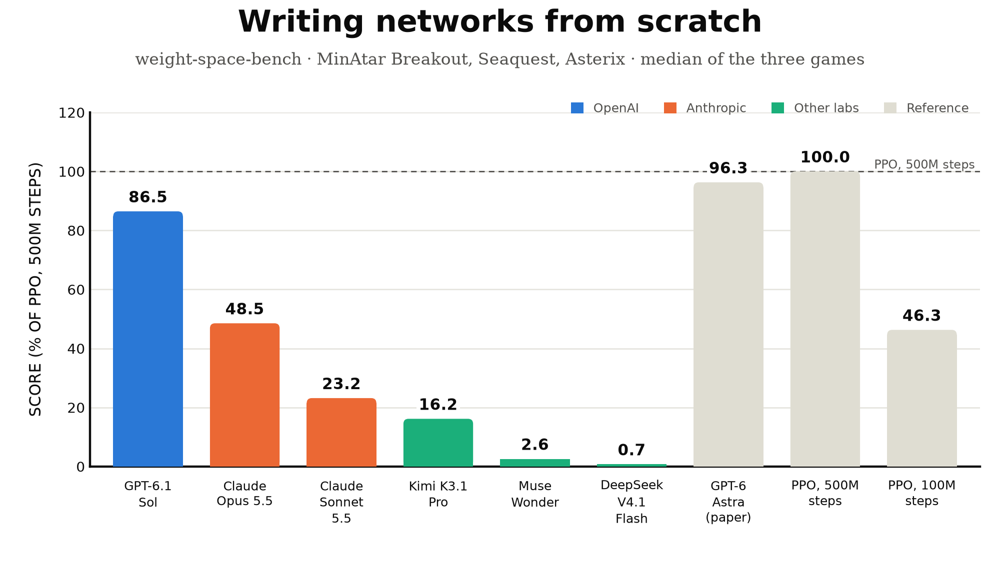
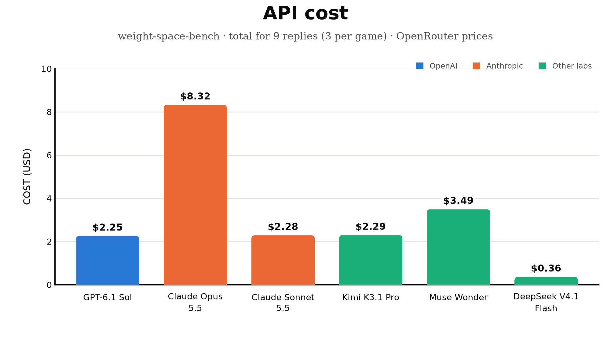
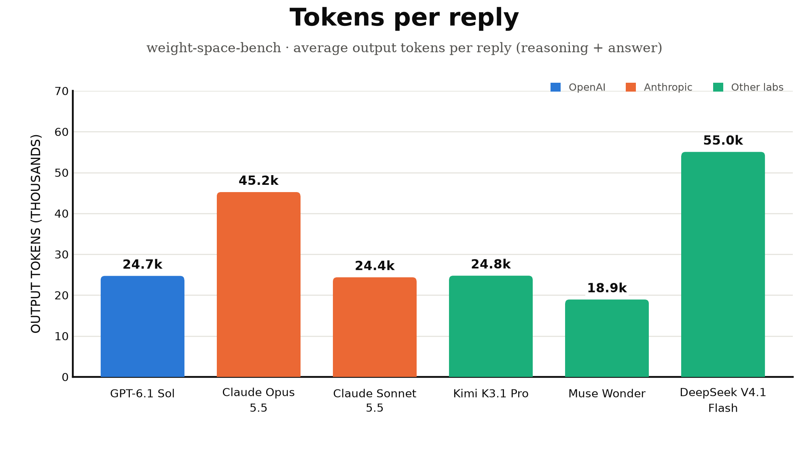

## Leaderboard: writing MinAtar networks from scratch

Score = median over the three games of the normalized score (0 = random play, 100 = the best PPO network trained for 500M steps). Raw = mean game score over 3 attempts x 1000 episodes.

| # | model | lab | score | Breakout (raw / % PPO) | Seaquest (raw / % PPO) | Asterix (raw / % PPO) | effort | API cost | tokens in / out per reply |
|---|---|---|---|---|---|---|---|---|---|
| 1 | GPT-6.1 Sol | OpenAI | **86.5** | 457.9 / 1844% | 11.8 / 13% | 47.8 / 86% | high | $2.25 | 3.3k / 24.7k |
| 2 | Claude Opus 5.5 | Anthropic | **48.5** | 17.5 / 69% | 2.9 / 3% | 27.0 / 49% | high | $8.32 | 4.8k / 45.2k |
| 3 | Claude Sonnet 5.5 | Anthropic | **23.2** | 6.6 / 24% | 1.0 / 1% | 13.2 / 23% | high | $2.28 | 4.8k / 24.4k |
| 4 | Kimi K3.1 Pro | Moonshot | **16.2** | 6.8 / 25% | 0.3 / 0% | 9.3 / 16% | high | $2.29 | 3.4k / 24.8k |
| 5 | Muse Wonder | Meta | **2.6** | 7.4 / 28% | 0.6 / 1% | 1.9 / 3% | high | $3.49 | 3.3k / 18.9k |
| 6 | DeepSeek V4.1 Flash | DeepSeek | **0.7** | 0.7 / 1% | 0.2 / 0% | 1.8 / 2% | high | $0.36 | 3.5k / 55.0k |
| | *GPT-6 Astra (paper)* | reference | *96.3* | 517.4 / 2084% | 53.1 / 60% | 53.2 / 96% | | | |
| | *PPO, 500M steps* | reference | *100.0* | 25.3 / 100% | 88.9 / 100% | 55.2 / 100% | | | |
| | *PPO, 100M steps* | reference | *46.3* | 15.8 / 61% | 5.6 / 6% | 25.8 / 46% | | | |
| | *random play* | reference | *0.0* | 0.55 / 0% | 0.09 / 0% | 0.49 / 0% | | | |

